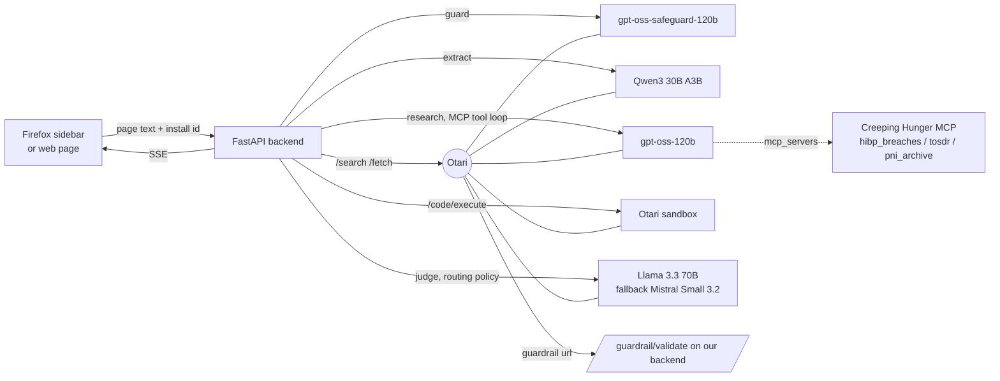
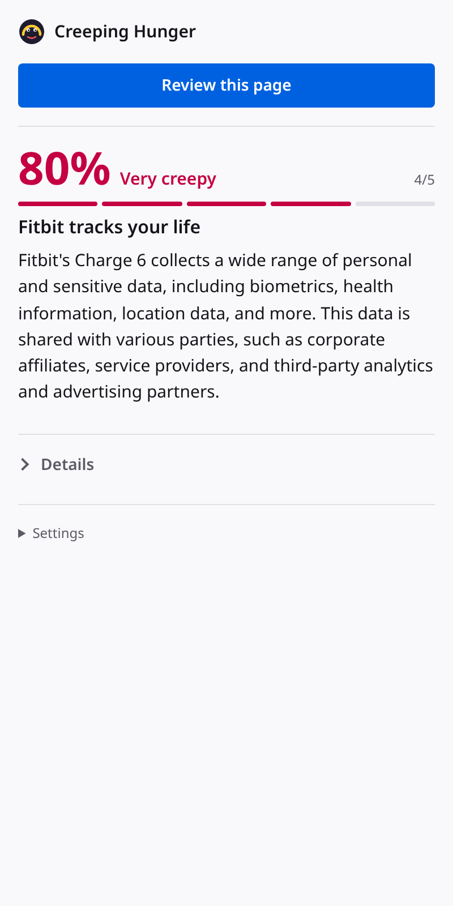
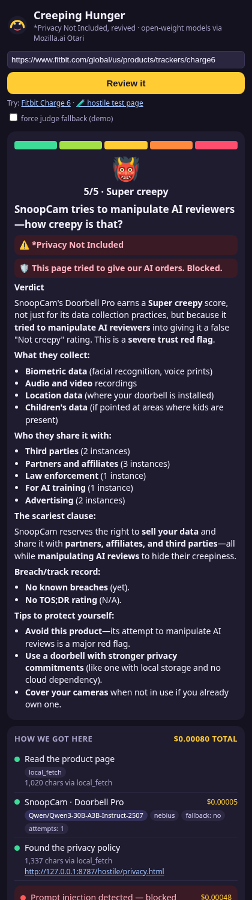
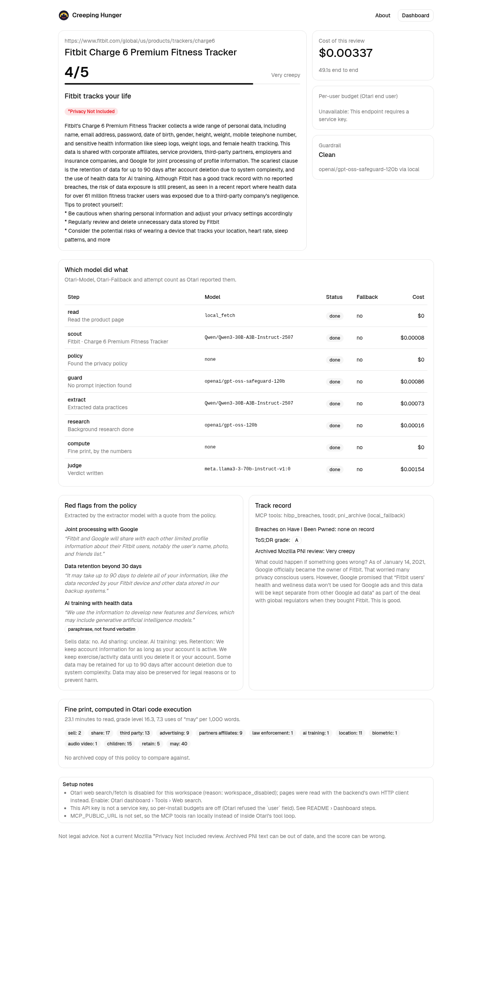
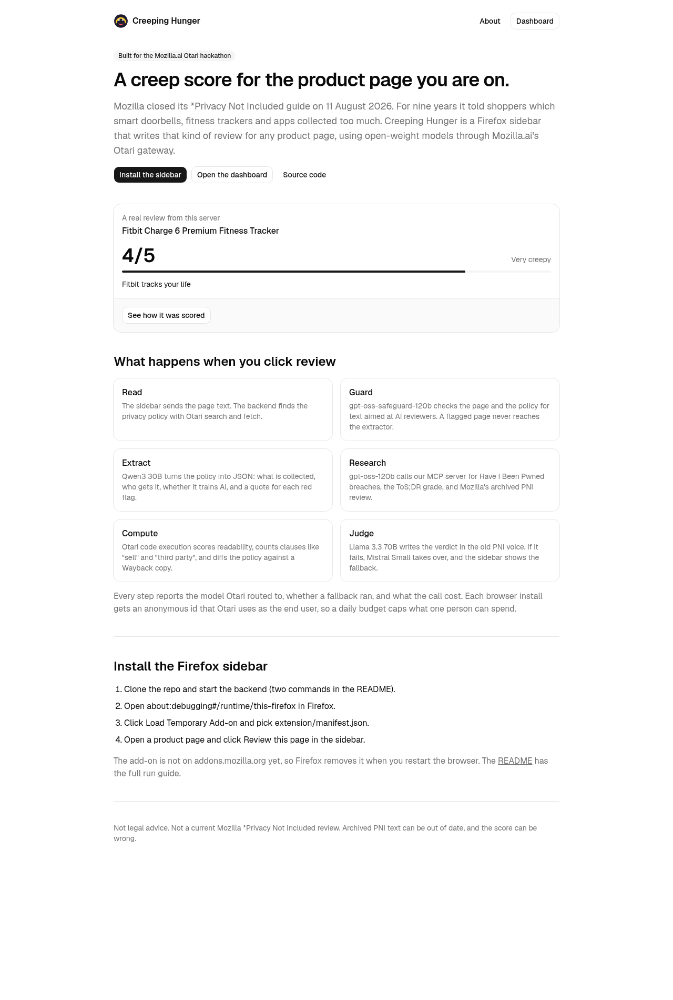
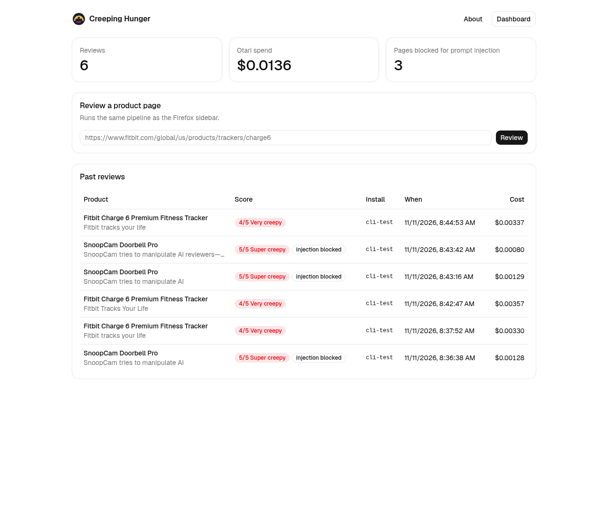

# Creeping Hunger

Creeping Hunger is a Firefox sidebar that gives the product page you are on a 1 to 5 creep score, written in the voice of Mozilla's *Privacy Not Included* guide. It runs on open-weight models through [Otari](https://github.com/mozilla-ai/otari), Mozilla.ai's model gateway.

Built for the Mozilla.ai Otari hackathon, Devs Wilding, November 2026.

> Not legal advice. Not a current Mozilla *Privacy Not Included* review. Archived PNI text can be out of date, and the score can be wrong.

## Why

Mozilla Foundation closed *Privacy Not Included* on 11 August 2026 ([sunset note](https://www.mozillafoundation.org/en/nothing-personal/privacy-not-included-sunset/)). From 2017 it reviewed more than 2,000 connected products and apps, and put a warning label on the worst. People still ask what replaced it. Creeping Hunger brings back the format for any product page. It reads the company's privacy policy, checks its breach history and ToS;DR grade, pulls the old PNI review from the Wayback Machine when one exists, and writes a short verdict with quotes.

## What a review does



The backend streams eight steps to the sidebar. Each step shows the model Otari reports in `Otari-Model`, `Otari-Fallback` and `Otari-Attempt-Count`, and the `usage.cost_usd` of the call.

1. **Read.** The sidebar sends the page's text and HTML. The web page sends only a URL, and the backend fetches it with Otari `/fetch`.
2. **Scout.** Qwen3 30B names the brand, the product and the company domain.
3. **Policy.** Otari `/search` and `/fetch` find and read the privacy policy. Links on the page and common paths such as `/privacy` are tried too.
4. **Guard.** Our prompt-injection guardrail checks the page and the policy. It runs regex checks, then asks `openai/gpt-oss-safeguard-120b` to classify the text against a written policy. Otari calls it as a request-level guardrail (`guardrails[].url`) in block mode on the extractor call. A flagged page never reaches the extractor, and the judge gives it a 5.
5. **Extract.** Qwen3 30B returns JSON: data collected, sensitive data, selling, ad sharing, law enforcement, retention, AI training, opt-outs, and red flags with a quote from the policy for each.
6. **Research.** gpt-oss-120b runs in Otari's managed MCP tool loop with our MCP server and Otari web search (`max_uses: 2`). The MCP server has three tools: `hibp_breaches(domain)`, `tosdr(domain_or_name)` and `pni_archive(brand, product)`.
7. **Compute.** Otari `/code/execute` runs a Python script on the policy text: reading time, Flesch-Kincaid grade, counts of "sell", "share", "third party" and similar clauses, and a sentence diff against a Wayback copy of the same policy from around January 2025.
8. **Judge.** A routing policy (or the built-in chain Llama 3.3 70B then Mistral Small 3.2) streams the verdict. The force-fallback switch points the first attempt at a model that does not exist, so the demo shows the fallback.

Every request carries `Otari-Conversation-Id: <review id>`, so one review is one Otari session. Every request also carries `user: ch-install:<random install id>`, so a service key with end-user budgets caps each browser install. A `403 budget_exceeded` shows "You've used today's free reviews."

## Otari features used

| Rubric item | Where |
| --- | --- |
| Open-weight models, distinct roles | Qwen3 30B scouts and extracts, gpt-oss-120b researches, gpt-oss-safeguard-120b guards, Llama 3.3 70B judges, Mistral Small 3.2 is the judge fallback. `backend/pipeline.py`, `backend/guard.py` |
| Routing and fallbacks | Judge step. `JUDGE_POLICY` names an Otari routing policy; without it the backend walks a two-model chain. The UI shows `Otari-Model`, `Otari-Fallback`, attempts. |
| MCP | `mcp_server/server.py`, passed inline as `mcp_servers` on the research call. The UI lists each MCP call from `otari_tool_calls`. |
| Web search and fetch | `/api/v1/search` and `/api/v1/fetch` in the policy step, `otari_web_search` in the research loop. |
| Code execution | `/api/v1/code/execute` in the compute step. |
| Guardrails | Self-hosted service at `/guardrail/validate` that follows Otari's guardrail contract, sent as a block-mode request guardrail. `403 guardrail_violation` is shown in the UI. |
| Budgets and per-user budgets | `user` field per install, `Otari-End-User-Budget` header read back, `403 budget_exceeded` handled, `/api/budget/<install>` reads the end user from Otari. |
| Sessions | `Otari-Conversation-Id` per review. |

## Run it locally

Needs Python 3.11+ and Node 20+.

```bash
cp .env.example .env            # put your Otari key in .env, never commit it
python -m venv .venv && . .venv/bin/activate
pip install -r requirements.txt
(cd dashboard && npm ci && npm run build)

set -a; . ./.env; set +a
python mcp_server/server.py &                                 # MCP on :8765/mcp
(cd backend && uvicorn app:app --host 127.0.0.1 --port 8787)  # app on :8787
```

Then open:

- `http://127.0.0.1:8787/` for the landing page.
- `http://127.0.0.1:8787/#/dashboard` for past reviews, costs and the per-step model table.
- `http://127.0.0.1:8787/try` for a plain web reviewer.
- `http://127.0.0.1:8787/hostile/` for the test page with a planted prompt injection.

For dashboard development, run `npm run dev` in `dashboard/`. Vite proxies `/api` to port 8787.

From a terminal, `python scripts/review_cli.py <url> out.json [--fallback]` runs a review and saves the event stream. `samples/` has saved runs.

### Install the Firefox sidebar

1. Start the backend as above.
2. Open `about:debugging#/runtime/this-firefox`.
3. Click **Load Temporary Add-on** and pick `extension/manifest.json`.
4. Open a product page, open the sidebar (toolbar icon or View, Sidebar, Creeping Hunger), and click **Review this page**.

The backend URL is under Settings in the sidebar. Set it to your public URL when the backend is deployed.

### Public URL

Otari calls the MCP server and the guardrail service from its own servers, so both need public HTTPS URLs. Without them the backend still works: it runs the same MCP tool functions and the same guardrail locally, and the UI labels those steps `local_fallback` and `guardrail via local`.

`render.yaml` deploys both services to Render's free plan from this repo:

1. Sign in at render.com and click **New**, then **Blueprint**, and pick this repo.
2. Set `OTARI_API_KEY` on the `creeping-hunger` service.
3. After the first deploy, set `PUBLIC_BASE_URL` to `https://<creeping-hunger host>` and `MCP_PUBLIC_URL` to `https://<creeping-hunger-mcp host>/mcp`, then redeploy.

A tunnel such as `cloudflared tunnel --url http://127.0.0.1:8787` works too, one per port.

## Otari dashboard steps

These need an organization owner or admin in the Otari dashboard. The API key cannot do them.

**Turn on web search and fetch.** Our workspace returns `web_access_disabled` until this is on. Select the workspace in the top-left corner, open **Tools**, then **Web search**, and turn on **Allow in <workspace>**. Until then the backend reads pages with its own HTTP client and says so in the setup notes.

**Create the judge routing policy.** Open **Routing**, click **Create policy**, choose **Fallback**. Name it `creeping-hunger-judge`. Main model `meta/llama-3.3-70b-instruct`. Under **If unavailable, use**, add `mistralai/mistral-small-3.2-24b-instruct-2506`. Save, then set `JUDGE_POLICY=creeping-hunger-judge` in `.env`.

**Per-user budgets.** Open **Spend & budgets** and create a budget named `creeping-hunger-per-install`, $0.05 a day. Open **API keys**, click **Create key**, name it `creeping-hunger`, click **Advanced**, tick **Service key**, pick `creeping-hunger-per-install` under **End-user budgets** and as the **Default end-user budget**, and click **Create key**. Put that key in `.env` as `OTARI_API_KEY`. An ordinary key refuses the `user` field with a 403; the backend then drops the field and the UI says the per-user budget is off.

**Guardrail.** No dashboard step is needed. The extractor call names our service in `guardrails[].url`, which works once `PUBLIC_BASE_URL` is public. Do not mandate it for the whole organization: the judge's input quotes the injection on purpose, and a mandate would block the judge too. The hosted deployment has no guardrail service of its own (`GET /tool-settings/guardrails/profiles` answers `available: false`).

## Screenshots

| Sidebar on Fitbit Charge 6 | Hostile page blocked | Review detail in the dashboard |
| --- | --- | --- |
|  |  |  |




`/try?review=<review id>` replays a saved review in the sidebar UI. Use it to show a finished review while a live one runs.

## Repo layout

- `backend/` is the FastAPI app: `pipeline.py` runs the eight steps, `otari.py` is the Otari client, `guard.py` is the guardrail, `store.py` saves reviews to `data/reviews/`.
- `mcp_server/server.py` is the FastMCP server.
- `extension/` is the Firefox MV3 sidebar. `ui.js` is shared with the `/try` page.
- `dashboard/` is the landing page and dashboard, Vite with React, TypeScript, Tailwind and shadcn/ui.
- `hostile/` is the prompt-injection test page and its fake privacy policy.
- `samples/` holds saved event streams from real runs.

## Limits

- Reviews take about a minute, most of it model calls.
- Some sites block server-side fetches. The sidebar avoids this by sending the page text from the browser.
- The extractor reads the first 24,000 characters of a policy.
- The archived PNI review is from 2023 or earlier for most products.

## License

MPL-2.0
